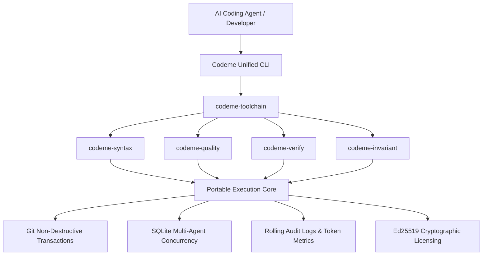

# Codeme Architecture Overview

Codeme is an autonomous code quality, verification, and invariant platform designed for developers, engineering teams, and AI coding agents.

## Core Principles
1. **Deterministic Execution:** No reliance on hosted LLMs or paid inference for verification gates.
2. **Universal Silent Success:** `exit 0` with zero bytes stdout/stderr.
3. **Offline-First:** Pro and Team operate up to 30 days offline; Enterprise operates indefinitely air-gapped.
4. **Git Safety:** Automated repairs execute in isolated transactions and rollback cleanly on failure.
